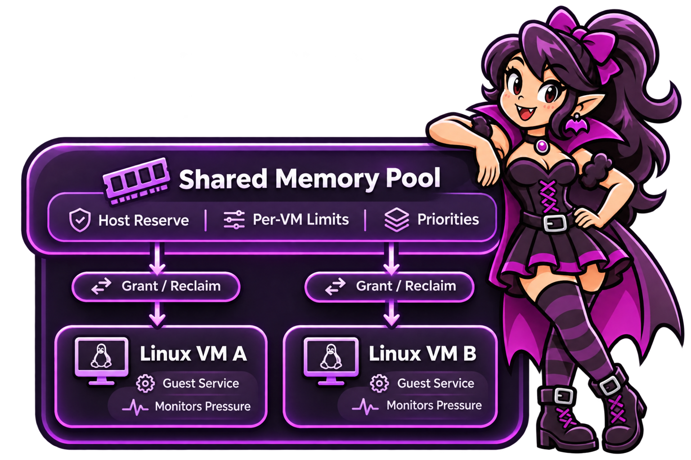

<div align="center">


# RAMpire

### Your VMs are hungry. Feed them only what they need.

**Automatic memory sharing for Linux virtual machines on KVM.**  
One shared pool. More responsive VMs. Less RAM sitting idle.

[](LICENSE)
[](#requirements)
[](Cargo.toml)

**[Get started](#get-started)** · **[See how it works](#how-it-works)** · **[Documentation](#documentation)** · **[Releases](https://github.com/macg4dave/RAMpire/releases)** · **[Report a bug](https://github.com/macg4dave/RAMpire/issues/new)**

</div>

---

## Make better use of the RAM you already own

If you run several VMs, you know the trade-off: give each one plenty of memory and waste RAM when it is idle, or keep allocations tight and risk running out when a workload gets busy.

**RAMpire gives your VMs room to breathe without permanently giving each one its maximum allocation.** Each Linux guest watches its own memory needs and requests more when needed. When demand falls, it can return unused memory to a shared pool. A controller on the KVM host coordinates the requests while respecting the limits you set.

Run a couple of services in a home lab or manage a larger set of VMs: the idea is the same. **Memory where it's needed, instead of where it was assigned at boot.**

## What you get

| | Feature | Why it matters |
|:--:|---|---|
| **01** | **Memory on demand** | Linux VMs can grow as workloads need more memory and give memory back when it is no longer needed. |
| **02** | **One shared pool** | Multiple VMs draw from the same host-managed allocation, rather than each holding its maximum all the time. |
| **03** | **Host-first safety** | A configurable host reserve and per-VM minimum and maximum sizes bound memory changes. |
| **04** | **Priorities that make sense** | When memory is scarce, important VMs can be served first. |
| **05** | **Live visibility** | See pool usage, individual VMs, resizing activity and recent decisions with `rampire top`. |
| **06** | **Friendly CLI, serious controls** | Guided setup, diagnostics, readable TOML settings, review-before-apply changes and rollback. |
| **07** | **Built for automation** | Machine-readable output, event logs, metrics and configuration-management workflows for larger setups. |

## How it works

<div align="center">



</div>

1. **Your guest knows what it needs.** The lightweight Linux guest service monitors memory pressure and available memory.
2. **Your host makes the decision.** The controller checks the shared pool, available host memory, VM limits and priority.
3. **The VM changes size.** RAMpire uses QEMU/libvirt **virtio-mem** to adjust the VM's memory and tracks the result.
4. **Idle capacity becomes available again.** Memory returned by one VM can be used by another.

The controller does **not** take memory away from a busy VM to satisfy a higher-priority one. Priorities determine how new requests are served when capacity is limited.

> **RAMpire isn't a way to create extra physical RAM.** It helps eligible VMs share available host memory more efficiently. Actual gains depend on your workload and how much memory your guests can safely return.

## Get started

The quick-start guide walks you from installation to your first managed VM, including host checks, guest installation and the VM's virtio-mem configuration.

**[Read the 10-minute quick start →](docs/quick-start.md)**

Once the host package is installed, the main flow is:

```bash
# Check that your KVM host meets the requirements
sudo rampire doctor

# Create a suggested configuration for this host
sudo rampire init

# Start the controller
sudo systemctl enable --now rampire

# After installing the Linux guest service inside the VM,
# add a VM (replace 'webserver' with its libvirt name)
sudo rampire vm add webserver --fix-xml

# See the pool and your VMs in action
sudo rampire top
```

`vm add` previews necessary VM-definition changes and guides you through the remaining choices. Some VM changes require a restart before memory management can begin.

**Looking for packages?** Check [GitHub Releases](https://github.com/macg4dave/RAMpire/releases) for published builds. The [release and repository installation guide](docs/releasing.md#installing-from-the-repositories) covers RPM, Debian and Ubuntu packaging. If there is no published release yet, follow the [development build instructions](docs/development.md#installing-a-development-build).

### Requirements

| Component | Requirement |
|---|---|
| **Host** | Linux with KVM, QEMU and libvirt; systemd-based installation |
| **libvirt** | **10.1+** |
| **QEMU** | **8.2+** and the required virtio-mem support |
| **Guest** | Linux VM with a compatible virtio-mem configuration and the RAMpire guest service |
| **Guest service** | systemd **253+** for the packaged Linux guest service |
| **Access** | Administrator access to the host and to each VM you want to enrol |

RAMpire has been exercised on **RHEL 10**. Other Linux distributions and packaged installation paths are being qualified; see [current validation work](docs/roadmap_next.md) before deploying on a new distribution.

## See what's happening

RAMpire is designed to explain its decisions, not just make them.

```bash
sudo rampire status                    # Current host and VM status
sudo rampire top                       # Live memory pool view
sudo rampire logs --since "1 hour ago" # Recent controller decisions
sudo rampire diff                      # Preview pending configuration changes
```

The live view shows your pool, the memory allocated to each VM, growth and shrink activity, free capacity and recent events. For longer investigations, the project includes detailed [monitoring and metrics tools](docs/tools.md).

<!-- Optional future enhancement: add a real terminal screenshot or short GIF here.
     Suggested path: docs/images/rampire-top.png
     Do not use a simulated screenshot in release documentation. -->

## Make it yours

You don't need to understand memory-management internals to change everyday settings. RAMpire stores human-readable configuration in `/etc/rampire/`.

```toml
# Example VM settings — /etc/rampire/vms.d/webserver.toml
priority = 100
min_ram = "2GB"
max_ram = "8GB"
free_ram = "512MB"
```

- **`min_ram` / `max_ram`** define the VM's memory boundaries.
- **`free_ram`** defines the spare memory the guest aims to retain.
- **`priority`** determines which requests are served first when the pool is short of memory.

These are illustrative settings, **not a complete configuration file**; RAMpire generates the VM-specific fields when you add a guest.

You can change a setting with a command rather than editing the file:

```bash
sudo rampire set webserver priority=150
```

Or edit the TOML, preview the change with `sudo rampire diff` and apply it with `sudo rampire apply`. A previous applied configuration can be restored with `sudo rampire rollback`.

**[Everyday usage guide](docs/usage.md)** · **[Full configuration reference](docs/reference.md)**

## For home labs and larger environments

**At home:** share idle memory between a web server, development VM, game server or other Linux guests. Start with the guided commands and tune the limits when you need to.

**At work or in a larger lab:** use reviewable configuration, recorded apply operations, JSON output, event logs, metrics and the project's configuration-management examples. RAMpire runs **one controller per KVM host**; it is not a cross-host memory pool.

**[Fleet operations and automation](docs/fleet.md)** · **[Administration and recovery](docs/administration.md)** · **[JSON formats](docs/json.md)**

## Platform support

| Platform / component | Current state |
|---|---|
| **Linux KVM host controller** | Working on RHEL 10 with libvirt and QEMU |
| **Linux guest memory management** | Working with virtio-mem |
| **Windows guest via virtio-mem** | Development paused due to an upstream `viomem` driver issue; not supported for deployment |
| **Windows via Hyper-V Dynamic Memory** | Planned; not implemented |

**Before running on an important host:** RAMpire is still progressing through its first-release validation. Read [administration and recovery](docs/administration.md) and the [remaining validation checklist](docs/roadmap_next.md). Test with non-critical VMs first.

## Documentation

| I want to… | Start here |
|---|---|
| Install RAMpire and add my first VM | [Quick start](docs/quick-start.md) |
| Understand daily commands and settings | [Usage guide](docs/usage.md) |
| Find every CLI option or configuration field | [Reference](docs/reference.md) |
| Operate, upgrade or recover a host | [Administration](docs/administration.md) |
| Monitor or record memory behaviour | [Tools and metrics](docs/tools.md) |
| Use automation or manage more than one host | [Fleet guide](docs/fleet.md) |
| Build, test or contribute code | [Development](docs/development.md) |
| Understand what is coming next | [Roadmap](docs/roadmap.md) · [Current work](docs/roadmap_next.md) |
| Integrate structured outputs | [JSON schemas](docs/json.md) · [Journal events](docs/journal.md) |

## Contributing and getting help

RAMpire is open source and welcomes practical feedback from people running real virtual machines.

Found a bug? Have an idea? Want to help test another distribution?

- [Open an issue](https://github.com/macg4dave/RAMpire/issues) with your host distribution, QEMU/libvirt versions, what you expected and what happened.
- [Read the development guide](docs/development.md) if you want to build or modify the code.
- Run `tools/gate.sh` before proposing code changes; it runs the project's formatting, build, test and lint checks.

Please avoid posting credentials, private VM data or unredacted logs in public issues.

## Licence

RAMpire is free and open-source software licensed under **[GPL-3.0-or-later](LICENSE)**. The archived upstream driver patch retains its original BSD-3-Clause licence; see [its archive](archive/viomem/README.md).

---

<div align="center">

**RAMpire** · *Sucking up idle memory. Feeding hungry VMs.*

[Get started](docs/quick-start.md) · [Explore the source](https://github.com/macg4dave/RAMpire) · [See the roadmap](docs/roadmap_next.md)

</div>
